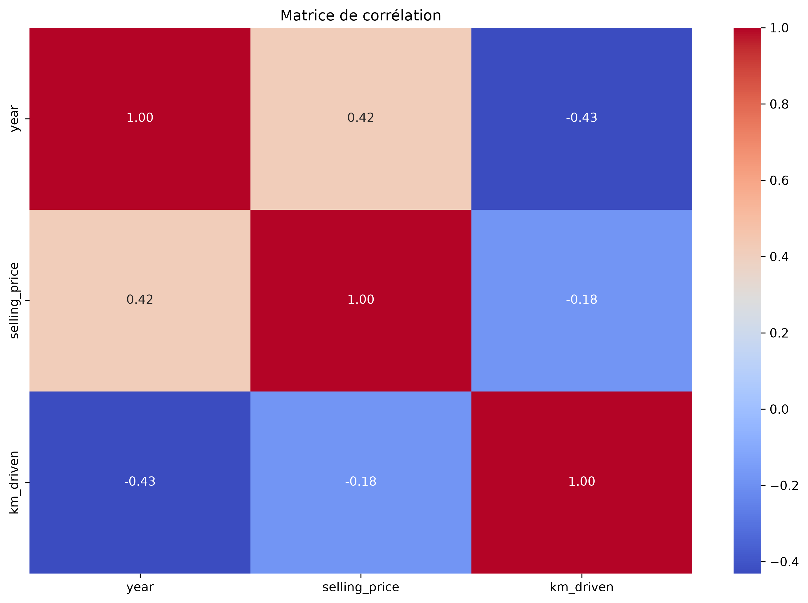
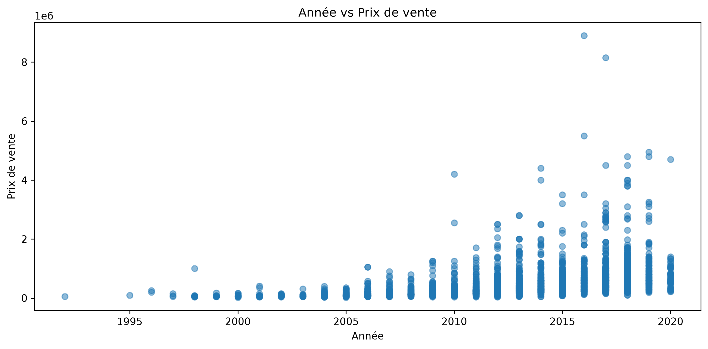
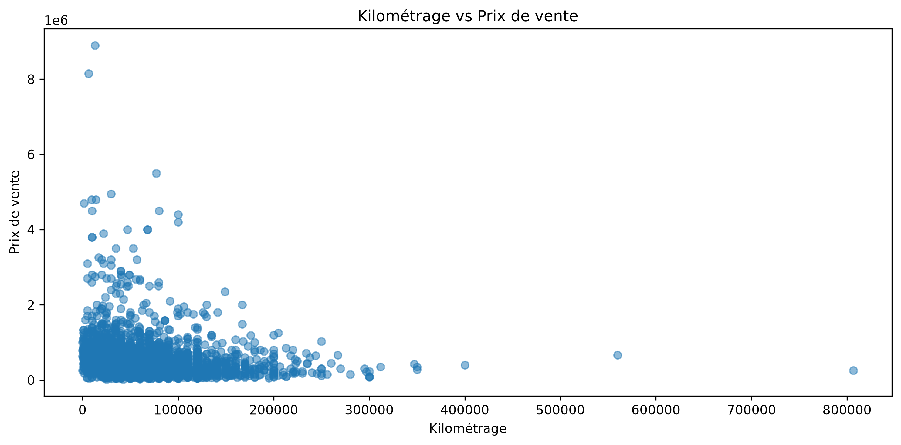
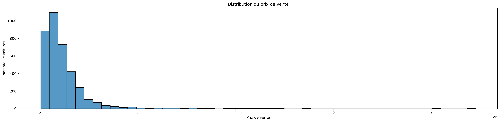
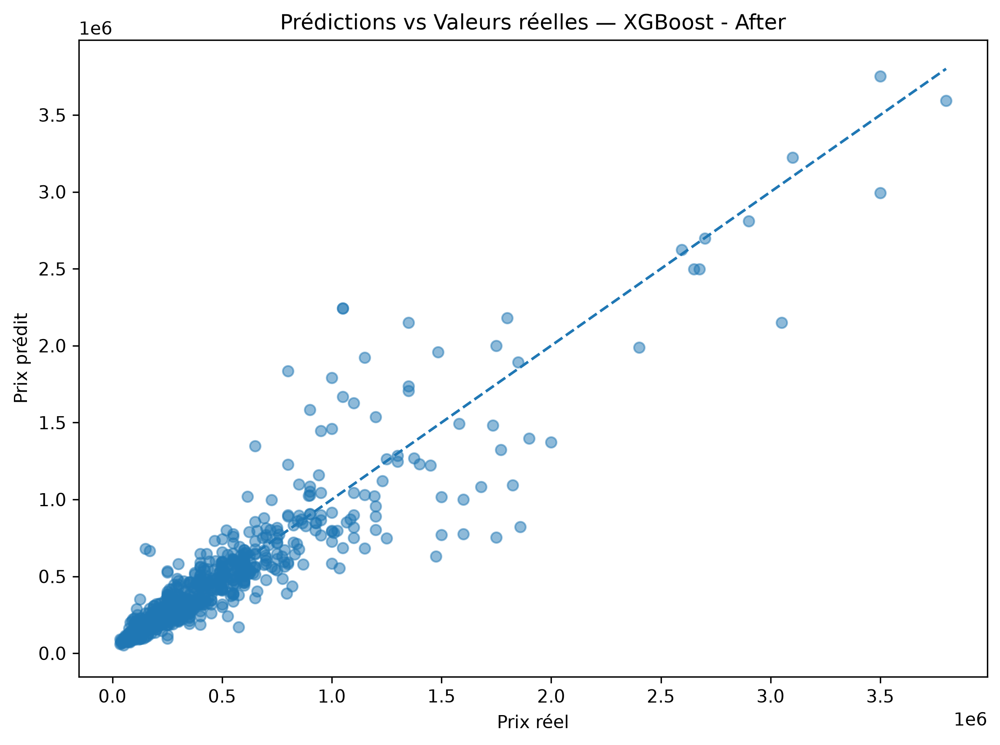
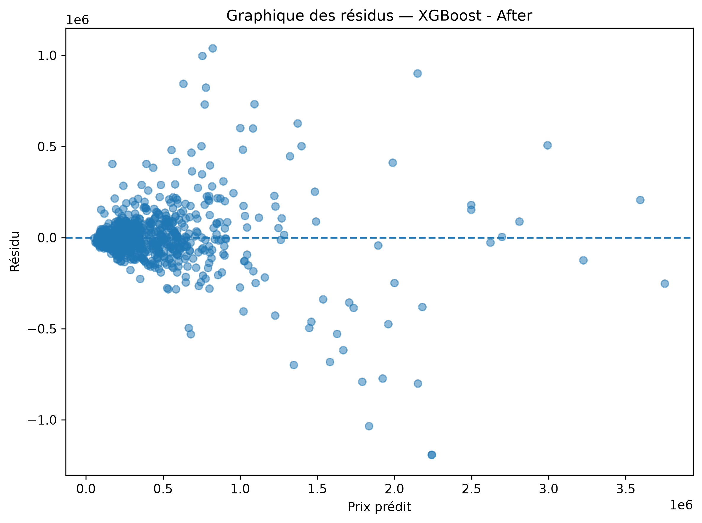

# 🚗 Car Price Predictor

> A used-car dataset entered the laboratory. Six regressors were invited to guess what a car is worth. One of them kept getting closer to the truth.

**Car Price Predictor** is an end-to-end machine learning project that investigates used-car prices, compares regression algorithms, and deploys the selected model through an interactive Streamlit application.

The repository brings together data cleaning, exploratory data analysis, feature engineering, model training, hyperparameter tuning, evaluation, and deployment. Rather than treating the prediction as a black box, the project preserves the evidence behind the final model: visualizations, evaluation metrics, and serialized preprocessing and model artifacts.

The experiment's current winner is a tuned **XGBoost Regressor**, achieving an \(R^2\) score of **84.10%** on the notebook's reported test split.

---

## 📌 Table of Contents

- [Project Overview](#-project-overview)
- [Dataset](#-dataset)
- [Machine Learning Workflow](#-machine-learning-workflow)
- [Model Evaluation](#-model-evaluation)
- [Interactive Prediction App](#-interactive-prediction-app)
- [Currency Conversion](#-currency-conversion)
- [Getting Started](#-getting-started)
- [Docker Deployment](#-docker-deployment)
- [Reproducing the Experiment](#-reproducing-the-experiment)
- [Project Structure](#-project-structure)
- [Technology Stack](#-technology-stack)
- [Limitations](#-limitations)
- [Final Verdict](#-final-verdict)

---

## 🔬 Project Overview

The goal is to estimate the selling price of a used car from its characteristics and ownership history.

The project explores the relationship between vehicle attributes and selling prices, then evaluates several regression algorithms to identify the strongest candidate for deployment.

**Key features**

- Exploratory data analysis with saved visualizations.
- Data cleaning, duplicate removal, and missing-value investigation.
- Feature engineering to represent vehicle age, usage intensity, and ownership history.
- Categorical encoding and numerical feature scaling.
- Comparison of six model configurations.
- Hyperparameter tuning with `GridSearchCV`.
- Evaluation using RMSE, MAE, and \(R^2\).
- Interactive price predictions through Streamlit.
- Docker-based application deployment.
- Optional display of estimates in multiple currencies.

## 📊 Dataset

The project uses a used-car dataset containing **4,340 original listings** and eight original columns.

| Feature | Description |
|---|---|
| `name` | Vehicle make/model name |
| `year` | Manufacturing year |
| `selling_price` | Listed selling price; prediction target |
| `km_driven` | Distance driven in kilometres |
| `fuel` | Fuel category |
| `seller_type` | Individual or dealer category |
| `transmission` | Manual or automatic transmission |
| `owner` | Previous-owner category |

After duplicate removal, the working dataset contains **3,705 rows**.

The target prices are expressed in **Indian rupees (INR)**, consistent with the source dataset. This is an Indian used-car dataset, not a Morocco-specific market dataset.

The complete investigation is documented in [`notebooks/exploration.ipynb`](notebooks/exploration.ipynb).

## ⚙️ Machine Learning Workflow

The notebook follows a reproducible investigation pipeline.

### 1. Data inspection and cleaning

- Inspect dataset dimensions, data types, and categorical values.
- Identify missing values and duplicate records.
- Remove duplicates and investigate incomplete entries.
- Examine price distributions and potential outliers.

### 2. Exploratory data analysis

The analysis investigates price distributions, relationships between vehicle characteristics and selling prices, and correlations between numerical features.

The generated visualizations are saved in [`graphs/`](graphs/).

### 3. Feature engineering

Several additional features are constructed to represent relationships that may influence resale value.

| Feature | Definition | Purpose |
|---|---|---|
| `car_age` | Reference year − manufacturing year | Represents vehicle age |
| `km_per_age` | Kilometres driven ÷ car age | Approximates usage intensity |
| `age_km` | Car age × kilometres driven | Captures an age–usage interaction |
| `brand` | First two words of the vehicle name | Provides a simplified make/model grouping |
| `age_owner` | Car age × encoded owner category | Captures an age–ownership interaction |

Categorical variables such as fuel type, seller type, and brand are one-hot encoded. Transmission and owner categories are converted to numerical representations.

The numerical `year` and `km_driven` features are standardized using a fitted `StandardScaler`.

**Preprocessing consistency matters:** the deployed application must reproduce the training feature definitions, column order, encodings, and scaling. The saved scaler and model must come from the same compatible training run.

### 4. Model training and tuning

The experiment compares these six configurations:

1. Linear Regression
2. Random Forest
3. XGBoost
4. Support Vector Regression (SVR)
5. Random Forest after hyperparameter tuning
6. XGBoost after hyperparameter tuning

`GridSearchCV` is used to tune the Random Forest and XGBoost configurations.

### 5. Model evaluation

The models are evaluated on the reported test split using:

- **RMSE:** penalizes larger prediction errors more heavily.
- **MAE:** measures the average absolute prediction error.
- **\(R^2\):** measures the proportion of target variation explained by the model relative to a mean-prediction baseline.

Residual analysis and predicted-versus-actual plots provide additional evidence about model behaviour.

---

## 🏆 Model Evaluation

The following results are the recorded outputs from the current notebook. Price-error metrics are expressed in the dataset's original price units (INR).

| Model | RMSE | MAE | R² |
|---|---:|---:|---:|
| Linear Regression | 416,919.84 | 245,797.46 | 0.2220 |
| Random Forest | 253,428.84 | 135,459.84 | 0.7125 |
| XGBoost | 195,290.55 | 112,728.50 | 0.8293 |
| SVR | 492,122.25 | 285,958.91 | -0.0840 |
| Random Forest — Tuned | 227,792.86 | 118,951.37 | 0.7677 |
| **XGBoost — Tuned** | **188,476.79** | **106,094.62** | **0.8410** |

### Selected model: Tuned XGBoost

The tuned XGBoost model achieved the strongest overall results in this comparison:

- **R²:** 0.8410 (84.10%)
- **RMSE:** 188,476.79 INR
- **MAE:** 106,094.62 INR

The model has the lowest RMSE and MAE, and the highest \(R^2\), among the configurations listed.

An \(R^2\) of 0.8410 does **not** mean that every prediction is 84.10% accurate. It indicates that the model explains approximately 84.10% of the target variation under the reported test evaluation.

The saved model is located at `models/xgboost_final.pkl`, with its fitted scaler at `models/scaler.pkl`.

---

## 📈 Evidence Wall

The notebook generates visual evidence to support the analysis and model evaluation.

### Dataset investigation

**Correlation matrix**



**Manufacturing year vs. selling price**



**Kilometres driven vs. selling price**



**Selling-price distribution**



### Model diagnostics

**Tuned XGBoost: predicted vs. actual prices**



**Tuned XGBoost residuals**



Additional distributions, boxplots, and model diagnostics are available in [`graphs/`](graphs/).

---

## 🖥️ Interactive Prediction App

The Streamlit application turns the trained model into an interactive interface.

Users can enter vehicle information, generate a price estimate, and choose how the predicted amount is displayed.

The interface accepts:

- Vehicle brand/model.
- Manufacturing year.
- Kilometres driven.
- Fuel type.
- Seller type.
- Transmission.
- Previous-owner history.
- Display currency.

The app loads the saved artifacts from `models/`. It does not retrain the model when a prediction is requested.

### Run locally

After installing the dependencies, launch the application:

```bash
streamlit run app.py
```

Open [http://localhost:8501](http://localhost:8501) in your browser.

---

## 💱 Currency Conversion

The underlying model predicts prices in **Indian rupees (INR)** because that is the currency used by the training dataset.

The application can display an estimate in other currencies, such as:

- INR — Indian Rupee
- MAD — Moroccan Dirham
- USD — US Dollar
- EUR — Euro
- GBP — British Pound

When fixed exchange rates are configured in `app.py`, the conversion is a presentation step applied to the model's INR prediction. It does not retrain the model or change the predicted vehicle value in the original dataset's market.

**Important:** if the application uses fixed exchange-rate values, they are illustrative and can become outdated. They should not be presented as live financial rates.

Currency conversion also does not make the model a reliable Moroccan-market valuation tool. Local taxes, vehicle availability, import costs, demand, and market pricing are not learned from this dataset.

---

## 🚀 Getting Started

### Prerequisites

- Python 3.10 or newer, compatible with your installed dependencies.
- Git.
- The project repository and its model artifacts.

Docker is optional if you prefer containerized deployment.

### 1. Clone the repository

```bash
git clone https://github.com/yakhlafhoussam/Car-Price-Predictor.git
cd Car-Price-Predictor
```

### 2. Create a virtual environment

```bash
python -m venv .venv
```

Activate it on Linux or macOS:

```bash
source .venv/bin/activate
```

On Windows PowerShell:

```powershell
.venv\Scripts\Activate.ps1
```

### 3. Install dependencies

```bash
python -m pip install --upgrade pip
pip install -r requirements.txt
```

### 4. Verify the required artifacts

Ensure these files exist:

```text
models/
├── scaler.pkl
└── xgboost_final.pkl
```

Both artifacts must be compatible with the features generated by `app.py`.

### 5. Launch the application

```bash
streamlit run app.py
```

Navigate to [http://localhost:8501](http://localhost:8501).

---

## 🐳 Docker Deployment

The repository includes a Dockerfile and a Compose configuration for running the prediction app in a container.

### Build and start

```bash
docker compose up --build
```

Open [http://localhost:8501](http://localhost:8501).

### Run in the background

```bash
docker compose up --build -d
```

### View logs

```bash
docker compose logs -f car-price-predictor
```

### Stop the application

```bash
docker compose down
```

The container exposes port `8501` and runs the Streamlit server on `0.0.0.0`, allowing the host machine to access the application.

If dependencies fail to install during the image build, check network connectivity and package compatibility, then retry the build.

---

## 🔁 Reproducing the Experiment

To reproduce the investigation:

1. Clone the repository and activate a Python virtual environment.
2. Install the dependencies from `requirements.txt`.
3. Open `notebooks/exploration.ipynb` in Jupyter Notebook or VS Code.
4. Execute the notebook cells in order.
5. Review the generated analysis and diagnostic plots.
6. Train and evaluate the candidate models.
7. Save the selected model and its matching fitted scaler.
8. Launch the Streamlit app and compare predictions against the recorded evaluation results.

The notebook should be treated as the source of truth for the reported metrics. Re-running the experiment can produce different results if the dataset, random seed, reference year, feature engineering, dependency versions, or train/test split changes.

---

## 🗂️ Project Structure

```text
Car-Price-Predictor/
├── app.py
├── data/
│   └── car-price.csv
├── graphs/
│   ├── correlation_matrix.png
│   ├── year_vs_selling_price.png
│   ├── km_driven_vs_selling_price.png
│   ├── distribution_selling_price.png
│   ├── predictions_vs_actual_xgboost_after.png
│   └── residuals_xgboost_after.png
├── models/
│   ├── scaler.pkl
│   └── xgboost_final.pkl
├── notebooks/
│   └── exploration.ipynb
├── Dockerfile
├── docker-compose.yaml
├── requirements.txt
└── README.md
```

*The tree illustrates the expected project layout; individual graph files may differ depending on the notebook outputs. The actual Compose filename should match the file committed to the repository.*

---

## 🧰 Technology Stack

| Technology | Role |
|---|---|
| Python | Core programming language |
| Pandas | Data manipulation and cleaning |
| NumPy | Numerical operations |
| Matplotlib | Visualization |
| Seaborn | Statistical plots |
| Scikit-learn | Preprocessing, evaluation, model selection, and baseline models |
| XGBoost | Final gradient-boosting regressor |
| Joblib | Model and scaler serialization |
| Jupyter Notebook | Experimentation and documentation |
| Streamlit | Interactive web interface |
| Docker | Containerized deployment |
| Docker Compose | Local container orchestration |

---

## ⚠️ Limitations and Considerations

- **Market scope:** the dataset reflects Indian used-car listings. Predictions should not be interpreted as direct estimates of Moroccan market prices.
- **Currency:** the model predicts INR-denominated prices. Currency conversion changes the displayed amount, not the underlying market context.
- **Model uncertainty:** even the best model makes errors. An estimate is not a guaranteed selling price or a professional vehicle appraisal.
- **Temporal effects:** vehicle prices and market conditions change over time. The reference year used in feature engineering must remain consistent with training.
- **Feature compatibility:** the app's preprocessing must exactly match the training pipeline. An incompatible model or scaler can produce incorrect predictions or runtime errors.
- **Data quality:** outliers, unobserved vehicle condition, regional demand, accident history, and other missing factors may affect prices.
- **Evaluation scope:** the reported scores apply to the notebook's test split and do not establish performance on every market or future dataset.

Serialized model files should only be loaded from trusted sources. Pickle-based artifacts can execute code during deserialization.

---

## 🧪 Final Verdict

The investigation began with 4,340 listings and a straightforward question: can a machine learn to estimate what a used car is worth?

After cleaning, feature engineering, model comparison, and hyperparameter tuning, XGBoost emerged as the strongest candidate in the reported experiment.

With an \(R^2\) of 0.8410 and an MAE of 106,094.62 INR, it earned its place in the prediction interface—not because it never gets the answer wrong, but because its results were strongest among the models tested.

**The verdict:** the best model is not the one that sounds convincing. It is the one whose predictions survive evaluation.

---

*Built as a machine-learning investigation into used-car price prediction, from exploratory analysis to a containerized interactive application.*